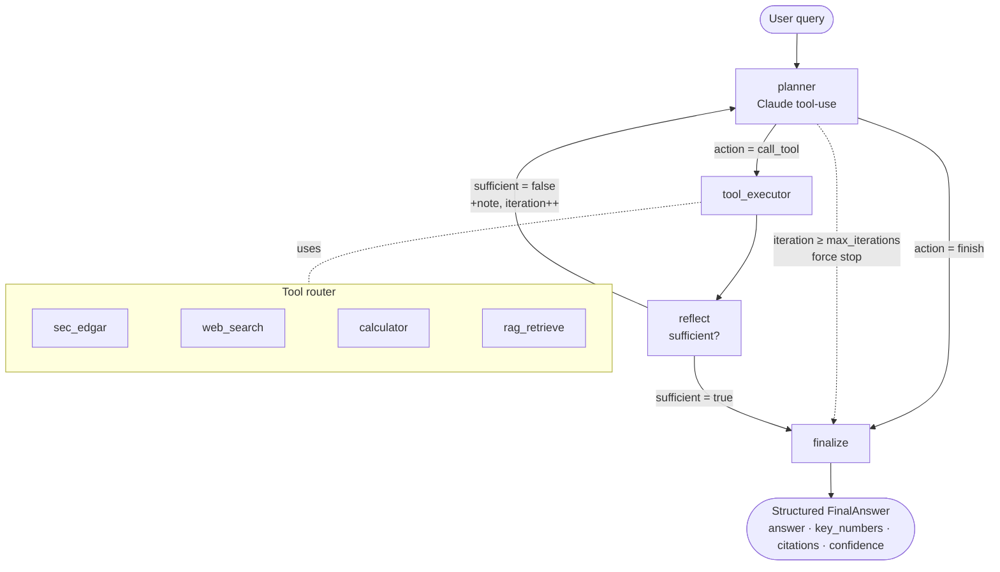

# FinAgent: LangGraph Financial Research Agent

A single LangGraph agent (planner + reflection) that answers financial-research questions
by **choosing which tool to call** — SEC EDGAR filings, web search, a sandboxed calculator,
or RAG over 10-K PDFs — then **reflecting on whether it has enough to answer** before
returning a **structured, cited** result.

Built as a portfolio project to be read end-to-end: the control flow is an explicit
state graph (not a black-box agent loop), and an **evaluation harness** measures tool
selection, numerical accuracy, and whether the reflection loop actually fires.

> Eval (n = 22 questions, Claude Sonnet 5 `claude-sonnet-5`; q07 ran on Claude Haiku 4.5):
> numerical accuracy **100%** (14/14 questions with a checkable number); reflection fired on
> **12/22** (8 for missing data, 4 because RAG was unavailable) and on **5/5** questions
> designed to need it; crashed runs **0/22**, runs with a tool error **5/22**.
> In this run only SEC EDGAR was exercised end to end; see [Known gaps](#known-gaps).
> Full report: [`evals/results/report_real.md`](evals/results/report_real.md).

---

## Architecture



The graph is a `StateGraph(AgentState)` compiled with a `MemorySaver` checkpointer, so
state is inspectable after every step. Four nodes:

- **planner** (Claude) — reads the question + everything gathered so far and emits a
  typed decision: call a specific tool (with args + a `reasoning` string) or finish.
- **tool_executor** — runs the chosen tool and records a `ToolCall` in state. Tool
  failures are captured, never raised, so the agent can reflect and recover.
- **reflect** (Claude) — a deliberately skeptical check: is the gathered information
  enough to fully answer? If not, it records what's missing and loops back to the planner
  (incrementing `iteration`; a hard `max_iterations` stop prevents infinite loops).
- **finalize** (Claude) — forces the answer through a Pydantic schema with real
  confidence logic (downgraded to `low` on a tool error or a forced stop).

---

## What's in the box

| Tool | What it does | Notes |
|---|---|---|
| `sec_edgar` | Official figures from `data.sec.gov` XBRL `companyconcept` API | No key needed (just a `User-Agent`); **concept aliasing** (asks for "Revenues", resolves the real `RevenueFromContractWithCustomerExcludingAssessedTax` tag); transparent on-disk **fixture cache** for reproducible/offline runs |
| `calculator` | Arithmetic for any derived value (margins, growth, diffs) | **Sandboxed AST evaluator — no `eval()`.** Whitelists `+ - * / // % **` and numbers; rejects names, calls, attribute access, comprehensions, lambdas, div-by-zero, huge exponents |
| `web_search` | News / context outside filings | Anthropic server-side `web_search` (default; reuses the same key), Tavily, or a `stub` for offline/CI |
| `rag_retrieve` | Passages from indexed 10-K PDFs | ChromaDB + Voyage/OpenAI embeddings; chunk → embed → cosine top-k with citations |

Plus: a **provider abstraction** (`anthropic` / `openai` / deterministic `mock`) so the
whole graph — including the reflection loop — runs with **zero keys** in tests and CI.

---

## Quickstart

```bash
# 1. Install (core). Add extras as needed: .[rag] .[openai] .[tavily] .[dev]
pip install -e ".[dev]"

# 2. Configure. Copy the template and add your key(s).
cp .env.example .env
#   ANTHROPIC_API_KEY=sk-ant-...        (required for real runs; also powers web_search)
#   SEC_EDGAR_USER_AGENT=FinAgent/0.1 (you@example.com)

# 3a. Ask a question (CLI)
python -m finagent "What was Apple's net profit margin in FY2025?"

# 3b. Or run it offline with no key at all (deterministic mock provider)
python -m finagent --provider mock "Compare Apple and Microsoft revenue"

# 4. Serve it as an API
uvicorn finagent.api:app --reload
curl -s localhost:8000/query -H 'content-type: application/json' \
     -d '{"query":"What was Apple revenue in FY2025?"}' | jq
```

RAG is opt-in and runs locally:

```bash
pip install -e ".[rag]"          # chromadb + voyageai + pypdf
python scripts/make_sample_filings.py     # build sample 10-K excerpt PDFs
python -m finagent.rag.ingest             # embed + index them into ChromaDB
```

---

## Example — a genuinely hard, ambiguous question

The dataset includes a deliberately underspecified question. Watch the reflection loop
resolve the ambiguity (real output from the committed eval run, Claude Sonnet 5):

**Q:** *"Is Apple or Microsoft more profitable, and by how much?"*

The planner pulls net income for one company; **reflect** flags that "profitability
typically requires margin comparison, not just absolute net income" and that Microsoft's
figures are missing — looping back **4 times** across **5 SEC look-ups** before answering:

```json
{
  "answer": "Apple generated a higher absolute net income than Microsoft, but Microsoft was more profitable on a margin basis. Apple (FY2025): Revenue $416.161B, Net Income $112.010B → net margin ≈ 26.9%. Microsoft (FY2025): Revenue $281.724B, Net Income $101.832B → net margin ≈ 36.1%. In absolute terms Apple earned ~$10.2B more; on margin Microsoft is ~9.2 percentage points higher. Which is 'more profitable' depends on whether you measure by total profit dollars or by profit margin.",
  "key_numbers": {
    "aapl_net_income_fy2025_usd": 112010000000,
    "msft_net_income_fy2025_usd": 101832000000,
    "aapl_net_margin_fy2025_pct": 26.92,
    "msft_net_margin_fy2025_pct": 36.15,
    "net_margin_difference_msft_minus_aapl_pct_points": 9.23
  },
  "confidence": "low",
  "tools_used": ["sec_edgar","sec_edgar","sec_edgar","sec_edgar","sec_edgar"]
}
```

Confidence is `low` because the first SEC look-up failed; `finalize` downgrades
confidence after any tool error or a forced stop.

---

## Evaluation

`evals/dataset.json` has **22 questions** spanning single-tool lookups, multi-tool
calculations, cross-company comparisons, RAG, web, and one deliberately ambiguous item.
`python evals/run_eval.py` runs each through the graph and writes a Markdown + JSON report.

Committed run: n = 22 questions, Claude Sonnet 5 (`claude-sonnet-5`) for 21 of them and
Claude Haiku 4.5 (`claude-haiku-4-5-20251001`) for q07.

| Metric | Value |
|---|---|
| Numerical accuracy (within tolerance) | **100%** (14/14 questions with a checkable number) |
| Answer-content checks passed | 90% (9/10) |
| Tool-selection accuracy (exact set) | 36.4% (8/22) |
| Tool-selection mean Jaccard | 0.674 (n=22) |
| Avg planner iterations / question | 1.14 (n=22) |
| Avg tool calls / question | 1.95 (n=22) |
| **Reflection fired** | **54.5% (12/22)**: 8 for missing data, 4 because RAG was unavailable |
| Reflection on questions designed to need it | 100% (5/5) |
| Confidence distribution | 14 high · 3 medium · 5 low (n=22) |
| Crashed runs | 0/22 |
| Runs with a tool error | 5/22 (4 RAG, 1 SEC); the agent finished each with low confidence |

The set is small (22 questions), so treat these numbers as a sanity check, not a benchmark.
In this run the calculator was never selected and RAG was not exercised end to end; see
[Known gaps](#known-gaps).

The reflection loop fired on 12/22 questions. In 8 of them it asked for data the planner
had not fetched yet, e.g.:

> *q07:* "Microsoft's FY2025 revenue is missing. We have Apple's FY2025 net income
> ($112,010M) and revenue ($416,161M)… However, for Microsoft, we only have net income for
> FY2025 ($101,832M) but not the corresponding revenue figure, so Microsoft's net profit
> margin cannot be calculated yet."

In the other 4 (the RAG questions) it reacted to the retrieval tool failing, and the
agent answered with low confidence instead of making up content:

> *q10 (RAG; chromadb was not installed for this run):* "Both retrieval attempts failed
> due to a module error (chromadb missing), so no actual content from Apple's 10-K
> regarding supply-chain risk has been retrieved yet."

Run it yourself:

```bash
python evals/run_eval.py --provider mock                 # offline, no key, deterministic
python evals/run_eval.py --provider anthropic --concurrency 4   # real run
python evals/run_eval.py --ids q07_compare_net_margin,q18_ambiguous_profitable
```

Run notes for the committed report are in
[`evals/results/report_real.md`](evals/results/report_real.md) (SEC served from committed
fixtures; RAG not exercised, see [Known gaps](#known-gaps)).

---

## Project structure

```
src/finagent/
├── graph.py            # LangGraph wiring: nodes, conditional edges, finalize
├── state.py            # AgentState (Pydantic) + ToolCall
├── schemas.py          # FinalAnswer / Citation / planner & reflect decisions
├── planner.py          # planner node prompt + tool schema
├── reflect.py          # reflection node prompt + tool schema
├── llm.py              # provider abstraction: anthropic | openai | mock
├── config.py           # env-based settings (.env), nothing hard-coded
├── api.py              # FastAPI: POST /query, GET /health
├── tools/              # sec_edgar, web_search, calculator, rag_retrieve (+ registry)
└── rag/                # ingest.py, store.py (chunk/embed/Chroma)
evals/                  # dataset.json, metrics.py, run_eval.py, results/
tests/                  # 30 unit + graph tests (offline)
scripts/                # make_sample_filings.py, capture_fixtures.py
.github/workflows/ci.yml# lint + tests + offline eval on push
```

---

## Design decisions

**Why LangGraph, not a plain agent loop.** A planner with a reflection step is only worth
something if the control flow is *explicit and inspectable*. One LLM plays the planner,
reflect and finalize roles; LangGraph gives named nodes and conditional edges you can point
at in a trace: the
planner's branch (`call_tool` vs `finish`), the reflection retry, and the
`max_iterations` force-stop are all real edges, not hidden inside a framework's while-loop.

**Why a planner that chooses tools, not a fixed pipeline.** The planner receives the
question + a compact history and picks one action at a time. The choice is visible
(`reasoning` is required on every decision) and shows up in the eval as "why this tool",
so tool choices can be checked against the expected ones.

**Why a reflection loop — and why the prompt ships a worked "not sufficient" example.**
Left to their own devices, models declare success early to stop. The reflect prompt
carries a concrete example of insufficiency, which is what makes it actually push back
(fired on 12/22 above, 5/5 where expected). A hard iteration cap keeps it from looping forever and
downgrades confidence honestly when it stops early.

**Why structured output (Pydantic + tool-use).** Free-form text can't be graded. Forcing
`key_numbers`, `citations`, and `confidence` through a schema is what makes the numerical
accuracy metric meaningful — and it's what turns the finalize step into a contract rather
than a paragraph. The finalize node also defensively repairs slightly malformed
structured output instead of crashing the run.

**Why a sandboxed calculator (no `eval`).** Letting an LLM's arithmetic through `eval`
is both a correctness and a security hole. An AST walker with an operator whitelist means
`__import__('os').system(...)` is rejected at parse time, and multi-digit math is done by
code, not "in the model's head" — when the planner calls it (in the committed eval it
never did; see Known gaps).

**Why a fixture cache on the SEC tool.** Evals shouldn't depend on live network or SEC
rate limits, and they should be reproducible. The tool fetches live by default and caches
every response; committed fixtures let the whole eval run deterministically offline.

**Why a provider abstraction with a mock.** CI must be green without secrets, and anyone
should be able to clone and run the graph end-to-end with no key. The `mock` provider is
a deterministic heuristic that still exercises the real tools and genuinely triggers the
reflection loop, so tests assert on real control-flow behavior.

### Known gaps

- **Only SEC EDGAR was exercised end to end in the committed eval run.** The calculator
  was never selected (0/22 questions), and RAG never returned results: all 4 RAG questions
  failed with `chromadb` not installed. Web search returned results in one question (q13);
  in q10, q11 and q22 it ran as the offline stub. SEC data came from the committed
  fixtures (`SEC_EDGAR_MODE=cache`), not live.
- **The eval is not a single-model run:** q07 ran on Claude Haiku 4.5, the other 21
  questions on Claude Sonnet 5.
- **Tool-selection exact-match is moderate (36.4%, 8/22).** Two causes: on derived values
  the model computes inline instead of calling `calculator`, and RAG questions fan out to
  fallback tools because retrieval failed. The first tool chosen was an expected one in
  22/22 questions (mean Jaccard 0.674). Enforcing calculator use (or a "no mental math"
  guard on multi-digit results) is the obvious fix.
- **RAG is unit-tested with an injected embedder; it has not been run end to end in the
  committed eval.**
- **Static ticker→CIK map** (AAPL/MSFT/GOOGL/AMZN/META): enough for the demo/eval; a
  fuller version would load the full `company_tickers.json`.

## Future work

- Enforce/verify calculator usage for any multi-digit derived value (raise tool-selection accuracy).
- Re-run the eval in one pass on one model, with RAG installed and indexed.
- Full ticker→CIK resolution + more XBRL concepts (segments, cash flow, balance sheet).
- Parallel tool calls in a single planner turn (fetch NI + revenue for a company at once) to cut steps/latency on comparisons.
- A/B the eval across providers (Anthropic vs OpenAI) — the abstraction is already there.
- Tracing (Langfuse) + a small UI over the existing API.
- Grounded-citation checking in the eval (verify each cited number appears in the cited source).

---

## Notes

- **Secrets:** only `.env.example` is committed; `.env` is gitignored. No keys anywhere in code.
- **Data:** SEC figures © SEC EDGAR (public domain). Sample filing PDFs are condensed,
  clearly-labelled excerpts for the RAG demo.

## License

MIT — see [LICENSE](LICENSE).
